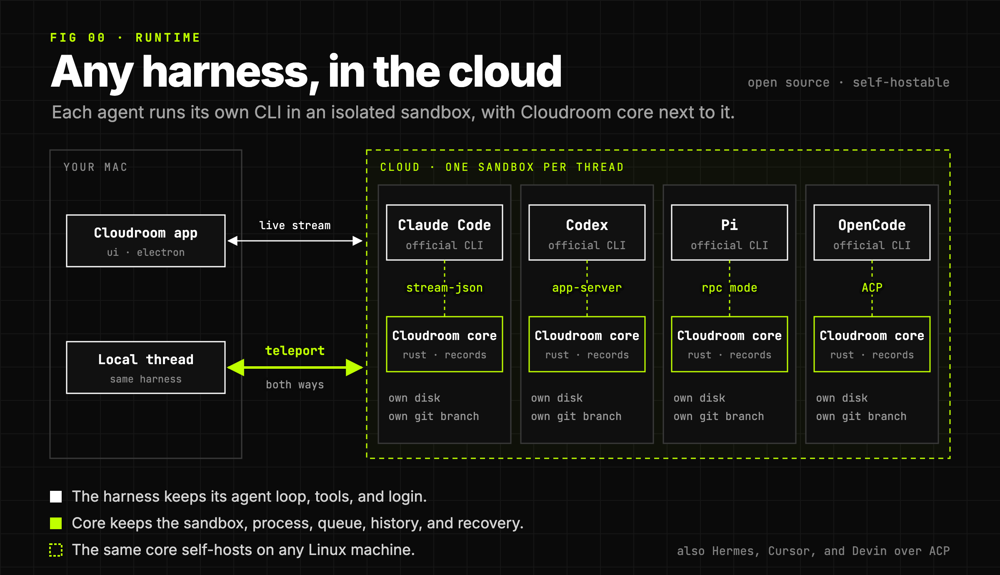
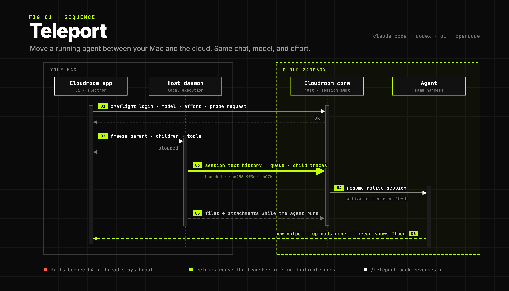
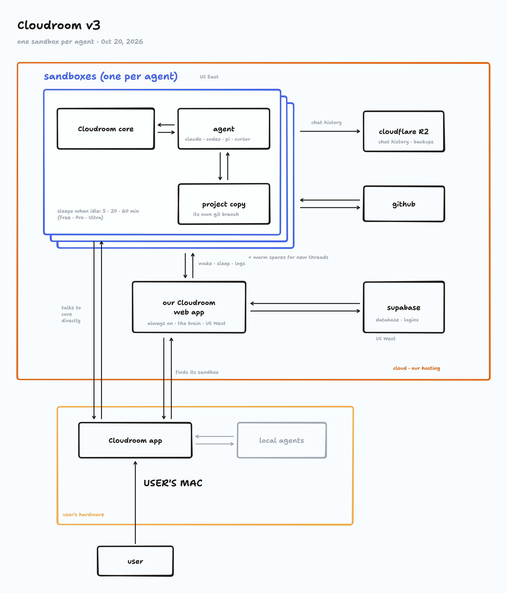

<p align="center">
  
</p>

<p align="center">
  <a href="#how-the-cloud-works"><b>How it works</b></a> ·
  <a href="core/docs/harnesses.md">Harness adapters</a> ·
  <a href="core/docs/setup.md">Self-host</a> ·
  <a href="core/docs/api.md">HTTP API</a> ·
  <a href="https://www.cloudroom.dev/download">Download</a>
</p>

<p align="center">
  <a href="https://github.com/davidondrej/cloudroom/releases/latest"></a>
  <a href="LICENSE"></a>
</p>

Cloudroom runs any coding agent harness in the cloud. Claude Code, Codex, Pi, OpenCode, and others run as their own CLIs, each in an isolated sandbox with its own Git branch. A running session can move between your Mac and the cloud.

## Why it exists

Coding agents like Claude Code and Codex are command-line programs. They run in one terminal, on one computer, and stop when it sleeps.

Claude Code on the web runs only Claude Code. Codex cloud runs only Codex.

Cloudroom divides the work. The harness keeps its agent loop, tools, and login. Cloudroom core, a Rust service, keeps the sandbox, the process, the queue, the recorded history, and recovery. 7 harnesses run this way today, over 4 native protocols.

Core records each harness's native session, so a running session can move. Teleport freezes it, moves its history, and resumes it on the other side, with the same chat, model, and effort.

For Apple Silicon Macs (macOS 13+), Linux x64, and Windows 11.

<p align="center">
  
</p>

## What's in this repo

- [`gui/`](gui/): the desktop app, built on [BB](https://github.com/get-bb/bb).
- [`core/`](core/): the Rust service that runs agents in the cloud and saves their history.
- [`skills/`](skills/): the skills every Cloudroom agent ships with.

## Get started

**Use the app.** [Download it](https://www.cloudroom.dev/download). It updates itself.

**Host the core yourself.** On Ubuntu 24.04:

```sh
curl -fsSL https://cloudroom.dev/install.sh -o install.sh
sudo bash install.sh
```

Then [connect the app](core/docs/setup.md#connect-the-desktop-app) with your server's URL and token. Full guide: [setup](core/docs/setup.md). [cloudroom.dev](https://www.cloudroom.dev) hosts the same core for you.

**Build from source.** The app: see [gui/README.md](gui/README.md). The core needs Rust 1.89+:

```sh
cd core
cargo build --locked --release
cargo test --locked --all-targets
```

Core docs: [HTTP API](core/docs/api.md) · [storage](core/docs/storage.md) · [harnesses](core/docs/harnesses.md) · [session lifecycle](core/docs/session-lifecycle.md) · [diagnostics](core/docs/observability.md) · [dashboard API](core/docs/dashboard.md)

## How the cloud works

Every Cloud thread gets its own sandbox, running Cloudroom core next to the agent. The app talks to it directly. Self-hosted, the same core runs on your own machine.

<p align="center">
  
</p>

## Security

- Agents run as a separate Linux user, with no admin rights.
- Every API request needs a secret token. The API listens only on localhost unless you put it behind HTTPS.
- History stays on your machine's own disk.
- Agents run without approval prompts, so give each trusted user their own machine.

Report vulnerabilities privately: see [SECURITY.md](.github/SECURITY.md).

## Contributing

Issues and pull requests are welcome. For big changes, open an issue first. See [CONTRIBUTING.md](.github/CONTRIBUTING.md).

Licensed under [Apache 2.0](LICENSE). BB's MIT notice is in [NOTICE](NOTICE).
