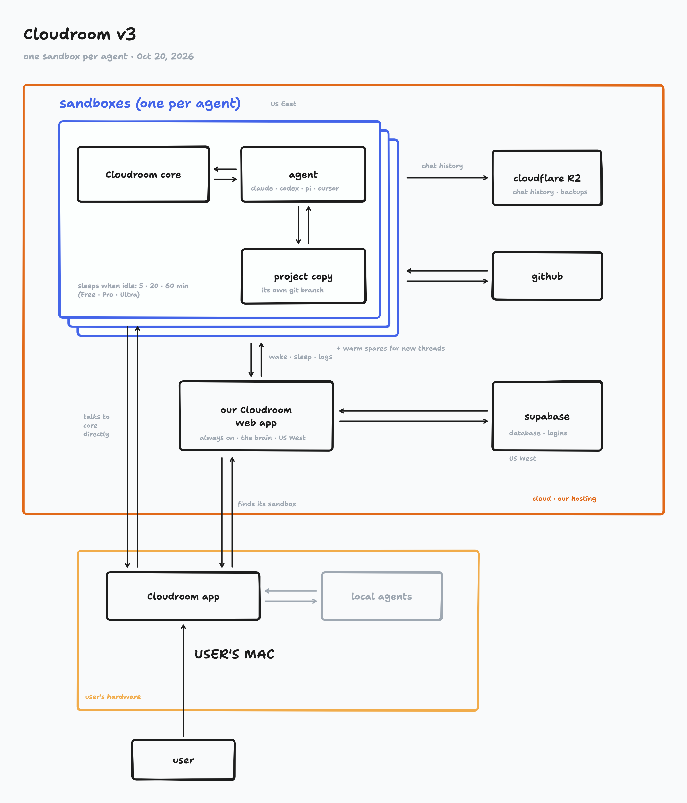

# Cloudroom

[Website](https://www.cloudroom.dev) · [Download the app](https://www.cloudroom.dev/download) · [Changelog](https://www.cloudroom.dev/changelog) · [Security](https://www.cloudroom.dev/security)

Your agents get their own room in the cloud.

This repo holds Cloudroom's open-source code: the [core](core/) and the [desktop app](gui/).

Cloudroom core runs coding agents on your own Linux machine and saves their chat history. It powers the cloud side of the Cloudroom app, which runs Claude Code, Codex, and Pi on your Mac or in the cloud.

- Works with Claude Code, Codex, Pi, OpenCode, Hermes, Cursor, and Devin.
- Agents use your own logins to call their models.
- One Rust service per machine. No Cloudroom account needed.

Don't want to host it yourself? [Get hosted Cloudroom free](https://www.cloudroom.dev).



## Get started

- [Install on Ubuntu 24.04](core/docs/setup.md) with one script, on a VPS, a home server, or a spare laptop. No database needed.
- [Reach it from your laptop](core/docs/setup.md#reach-it-from-your-other-devices) with Tailscale, and [upgrade](core/docs/setup.md#upgrade) in place.
- [HTTP API](core/docs/api.md): every endpoint, event, and error code.
- [Linux builds](https://github.com/davidondrej/cloudroom/releases): tested core binaries for each release.

## Security

- Agents run as a separate Linux user, with no admin rights and no `sudo`.
- Agents can't read the core's token or history files.
- Every API request needs a secret token. The API listens only on localhost unless you put it behind HTTPS.
- History stays on the machine's own disk. [Back it up](core/docs/setup.md#3-saved-history) like any other folder.
- Command Guard blocks a few disastrous commands, like wiping a home folder.

Agents run without approval prompts, so give each trusted user their own machine.
Report vulnerabilities privately: see [SECURITY.md](.github/SECURITY.md).

## Desktop app

[Download the Cloudroom app](https://www.cloudroom.dev/download) for Macs, Linux, and Windows. [Connect it to your own core](core/docs/setup.md#connect-the-desktop-app) with a URL and token, no account needed. The core also works without it. To build the app yourself, see [gui/README.md](gui/README.md).

## Build and test the core

Needs Rust 1.89+, Git, and the agent CLIs you want to run.

```sh
cd core
cargo build --locked --release
cargo test --locked --all-targets
```

More docs: [storage](core/docs/storage.md) · [harnesses](core/docs/harnesses.md) · [session lifecycle](core/docs/session-lifecycle.md) · [diagnostics](core/docs/observability.md) · [dashboard API](core/docs/dashboard.md)

## Contributing

Issues and pull requests are welcome. For big changes, open an issue first. See [CONTRIBUTING.md](.github/CONTRIBUTING.md).
This is pre-release software. Licensed under [Apache 2.0](LICENSE). The app is built on [BB](https://github.com/get-bb/bb); its MIT notice is in [NOTICE](NOTICE).
