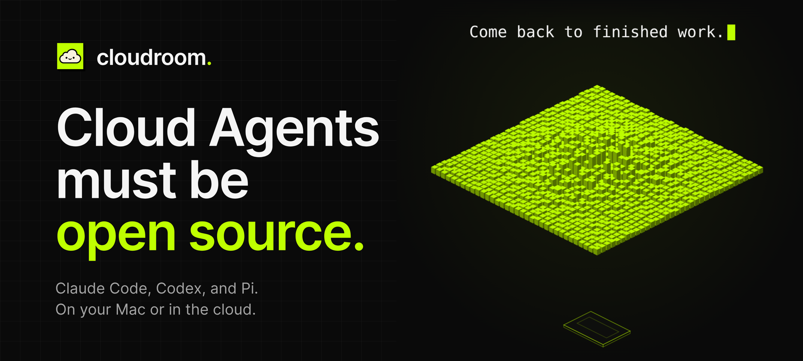
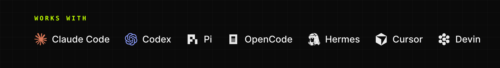
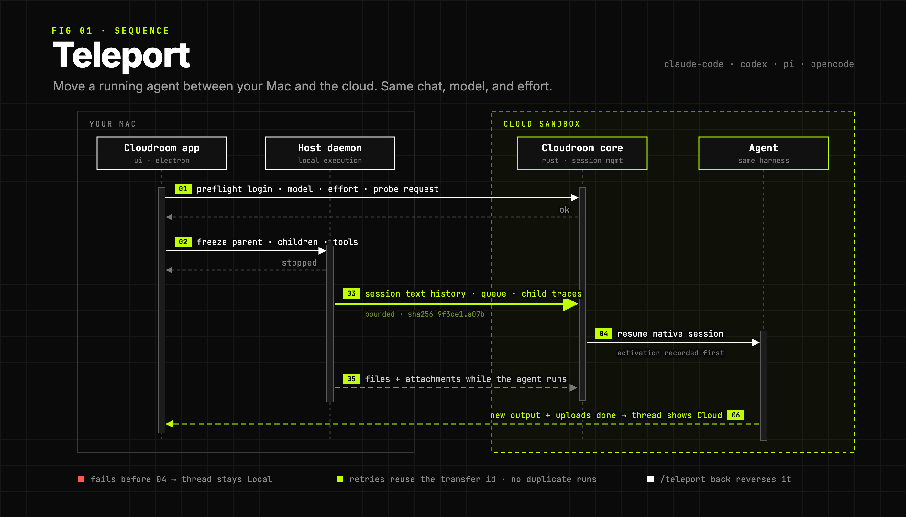
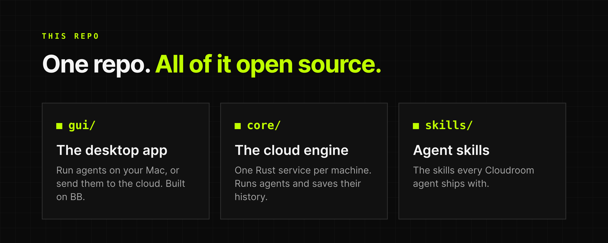

<p align="center">
  
</p>

<p align="center">
  <a href="https://www.cloudroom.dev/download"><b>Download</b></a> ·
  <a href="https://www.cloudroom.dev">Website</a> ·
  <a href="https://www.cloudroom.dev/changelog">Changelog</a> ·
  <a href="core/docs/setup.md">Self-host</a> ·
  <a href="https://www.cloudroom.dev/security">Security</a>
</p>

<p align="center">
  <a href="https://github.com/davidondrej/cloudroom/stargazers"></a>
  <a href="https://github.com/davidondrej/cloudroom/releases/latest"></a>
  <a href="LICENSE"></a>
</p>

Cloudroom is a desktop app for AI coding agents. Start them on your Mac, or give each one its own computer in the cloud. Close your laptop, and they keep working.

<p align="center">
  
</p>

## Features

- **Local and Cloud, side by side.** Each Cloud thread gets its own sandbox and Git branch.
- **Your own subscriptions.** Agents use your Claude and ChatGPT logins, with no token markup.
- **Mac access.** Cloud agents can reach your Mac. You pick Off, Read-only, Ask first, or Full.
- **Teleport.** Move a running thread to the cloud and back. Same chat, model, and effort.
- **Your own cloud.** Run the core on your own Linux machine. No Cloudroom account needed.

For Apple Silicon Macs (macOS 13+), Linux x64 (alpha), and Windows 11 (beta).

<p align="center">
  
</p>

## What's in this repo

<p align="center">
  
</p>

- [`gui/`](gui/): the desktop app, built on [BB](https://github.com/get-bb/bb).
- [`core/`](core/): the Rust service that runs agents in the cloud and saves their history.
- [`skills/`](skills/): the skills every Cloudroom agent ships with.

## Get started

**Use the app.** [Download it](https://www.cloudroom.dev/download). It updates itself.

**Host the core yourself.** On Ubuntu 24.04:

```sh
curl -fsSL https://cloudroom.dev/install.sh -o install.sh
sudo bash install.sh
```

Then [connect the app](core/docs/setup.md#connect-the-desktop-app) with your server's URL and token. Full guide: [setup](core/docs/setup.md). Don't want to host it? [Get hosted Cloudroom free](https://www.cloudroom.dev).

**Build from source.** The app: see [gui/README.md](gui/README.md). The core needs Rust 1.89+:

```sh
cd core
cargo build --locked --release
cargo test --locked --all-targets
```

Core docs: [HTTP API](core/docs/api.md) · [storage](core/docs/storage.md) · [harnesses](core/docs/harnesses.md) · [session lifecycle](core/docs/session-lifecycle.md) · [diagnostics](core/docs/observability.md) · [dashboard API](core/docs/dashboard.md)

## How the cloud works

Every Cloud thread gets its own sandbox, running Cloudroom core next to the agent. The app talks to it directly. Self-hosted, the same core runs on your own machine.

<p align="center">
  
</p>

## Security

- Agents run as a separate Linux user, with no admin rights.
- Every API request needs a secret token. The API listens only on localhost unless you put it behind HTTPS.
- History stays on your machine's own disk.
- Agents run without approval prompts, so give each trusted user their own machine.

Report vulnerabilities privately: see [SECURITY.md](.github/SECURITY.md).

## Contributing

Issues and pull requests are welcome. For big changes, open an issue first. See [CONTRIBUTING.md](.github/CONTRIBUTING.md).

Licensed under [Apache 2.0](LICENSE). BB's MIT notice is in [NOTICE](NOTICE).
